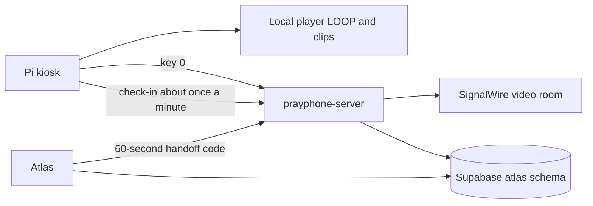

# Pray Phone system design

How the kiosk, the conferencer, and Atlas fit together. Customer language is in [README.md](./README.md). Staff steps are in [interaction-procedures.md](./interaction-procedures.md). Operator commands are in [troubleshooting.md](./troubleshooting.md).

Three repositories:

| Repository | Role |
| --- | --- |
| `prayphone-device` | Raspberry Pi kiosk: keypad, handset, local video, Chromium |
| `prayphone-server` | Conferencer. Heroku app `prayphone`, origin `https://prayphone-68d333045316.herokuapp.com` |
| `atlas` | Staff sign-in, phone icon, fleet screen, Supabase data |

The conferencer stays on prayphone-server. Atlas does not host the call page.



## Bill of materials

Parts named in the device repository:

| Part | What the repo says |
| --- | --- |
| Computer | Install notes name a Raspberry Pi 3B+, 4B, or 5 with Raspberry Pi OS. The model inside a given unit is ________ |
| Display | HDMI (High-Definition Multimedia Interface) display |
| Keypad | 4×3 matrix on General Purpose Input/Output (GPIO). Brand and model ________ |
| Handset | Single-pole double-throw limit switch. Common is ground. Handset model ________ |
| Camera | Camera service is written for a Camera Serial Interface (CSI) Pi Camera Module 3 (IMX708), bridged to `/dev/video8` |
| Power | ________ |
| Enclosure | ________ |
| Network | The kiosk can join a Wi-Fi network with NetworkManager (`nmcli`) when fleet config supplies a name and passphrase. The radio and how a unit is normally cabled are ________ |

## Kiosk operation

`prayphone.service` runs `src/kiosk2.py` as user `ppadmin`.

On boot the process starts a loopback bridge (`src/kiosk_bridge.py`, port 8765) and opens Chromium on `http://127.0.0.1:8765/`. That page is `src/player.html`. It plays `LOOP.mp4` from the device video directory. The default directory in `config/config.json` is `~/Videos/mp4s/`. Idle playback does not need the network.

`LOOP.mp4` plays at startup, after every `1`–`9` clip (and after `*` / `#` when those files exist), and after every call. The local player stays. Key `0` is the only path into the hosted call.

| Key | What happens |
| --- | --- |
| `1`–`9` | Play `1.mp4`–`9.mp4`, then return to `LOOP.mp4` when the clip ends. A missing file leaves the loop playing |
| `*` / `#` | Play `star.mp4` / `hash.mp4`, then return to the loop |
| `0` | Open `https://prayphone-68d333045316.herokuapp.com/kiosk/call?bridge=http://127.0.0.1:8765&return=local` |

`return=local` sends the browser back to the local player when the call ends.

If Chromium is closed or crashes, `mpv` plays `LOOP.mp4` until Chromium starts again. Escape in the player asks the bridge to close Chromium. The next key press opens it again and carries that key.

## Keypad and hook switch

BCM (Broadcom pin numbering) in `src/kiosk2.py`. Rows are outputs. Columns are inputs with pull-down.

| Keypad row | BCM | Keypad column | BCM |
| --- | --- | --- | --- |
| Row 1 | 25 | Column 1 | 22 |
| Row 2 | 12 | Column 2 | 17 |
| Row 3 | 13 | Column 3 | 4 |
| Row 4 | 16 | | |

```
[1] [2] [3]
[4] [5] [6]
[7] [8] [9]
[*] [0] [#]
```

The hook switch, from `config/config.json`:

- On-hook (handset down) grounds BCM 7.
- Off-hook (handset up) grounds BCM 6.
- Both contacts use pull-up. A made contact reads low.
- Both high means the switch is between contacts and is ignored.
- Both low is treated as a wiring fault and is ignored.

Lift: start a hook session and restart `LOOP.mp4` from the beginning.

Replace: save the hook-to-hook session (start, end, duration, keys, and the call id if one exists) and return to the loop. If a call session id is present, the device asks the conferencer to end that session (`receiver_on_hook`).

If the handset is already down and a call session id appears, the same hang-up runs. A call stays up while the off-hook contact is the one that is grounded.

Every key press is stored in the local catalog and posted to the device-log Application Programming Interface (API), `POST /api/device-logs`, with subject `keypad_press`.

## From kiosk to conference

Key `0` loads `/kiosk/call` in the same Chromium window. `app/kiosk/call/page.tsx` mounts `components/BackendIntercom.tsx` in kiosk mode. There is no Atlas login on that page.

When the kiosk page is ready it creates a session with `POST /api/signalwire/calls`, then:

1. Posts `{ sessionId }` to the loopback bridge `POST /session`.
2. Asks `POST /api/signalwire/room-token` for a SignalWire video room token.
3. Joins that room and publishes the camera at `/dev/video8` and the microphone.

The agent page is `/agent`. It uses the same `BackendIntercom` component in agent mode. The console lists active sessions. Staff press a session row, then **answer call**, which joins that session id.

When both the kiosk participant and the agent participant are recorded as joined, the session state becomes `joined`.

Phase 6, a design for six concurrent calls with agent identities `agent-1` through `agent-6`, is parked. It is not what this code runs.

## Mobile caller

The phone app lives in the workspace at `prayphone/mobile`. It is one Expo project for iPhone and Android. An Atlas participant signs in with the same Supabase account as the web app, sees keys `1`–`9`, and presses `0` to call the agency.

Key `0` does not open `/kiosk/call` and does not use the Pi bridge. The app sends `POST /api/signalwire/mobile-calls` with the signed-in user's bearer token and its device id (`EXPO_PUBLIC_DEVICE_ID`, otherwise `prayphone-mobile-001`). The conferencer loads that row from `atlas.prayphone_devices`. `calls_as_device_id` places the call as another enabled phone. The caller address is `signalwire_identity` on the phone it is calling as. The live call is a SignalWire video room. That column is the address the agent console shows. It is not a Session Initiation Protocol (SIP) password and it is not a separate SIP registration.

`prayphone-mobile-001` is seeded with its own `signalwire_identity` and with `calls_as_device_id` set to `prayphone-device-001`. Key `0` on the phone therefore rings as the field kiosk. Clear `calls_as_device_id` to make the same install ring as `prayphone-mobile-001`. `MOBILE_PROXY_DEVICE_ID` on the conferencer is the device id used when the app omits one.

The conferencer rings the same inbound row the kiosk uses and returns a 60-second code. The call screen injects that code into `/mobile/call`. The code is not a session token and is not placed in the address bar. The page trades it once for a SignalWire room token and joins with the phone camera and microphone.

Staff still answer on `/agent`. The console row shows the caller address. The phone joins under a `kiosk-` room name so the existing answer path can mark the room joined. Keys `1`–`9` only record which topic was pressed. Clip playback is later work.

## Atlas identity handoff

Atlas login stays in Atlas. `src/features/atlas2026/singlepane/data-access/prayphoneSubapp.ts` opens the agent origin plus `/agent`.

The built-in origin is `https://prayphone-68d333045316.herokuapp.com`. `VITE_ATLAS_PRAYPHONE_URL` can replace it. Vite reads that variable at build time (`import.meta.env` in the Atlas app, and `heroku-postbuild` runs `vite build`). A change takes effect on the next build and deploy. Docs in this repo name the Atlas Heroku app `atlas-simplified`. The slug `atlas-simplified-db949a616d2d` is ________ in this repository.

On click, Atlas calls Remote Procedure Call (RPC) `atlas.fn_create_prayphone_handoff()`. That inserts a 60-second, single-use, 64-character hex code for the signed-in user. The code is placed in the address-bar fragment as `atlas_handoff`. `components/AgentAuthGate.tsx` posts it to `POST /api/atlas-handoff`, verifies the returned magic-link hash with Supabase, and strips the fragment before the rest of the page runs. The session token is not placed in the Uniform Resource Locator (URL). A copied link cannot be reused to sign in.

A direct visit to `/agent` uses Atlas email, Google, or Apple sign-in, then the same capability check.

Capability is `atlas.fn_can_access_warmline_agent()`, which returns `atlas.fn_has_permission('warmline_agent.access')`. Administrators and supervisors are seeded with that permission. An administrator can deny a supervisor. Navigators need a non-expiring allow exception (Admin Directory, or the supervisor roster function `atlas.fn_supervisor_set_navigator_warmline_access`). Partners do not receive it by role. The permission name stays `warmline_agent.access`.

## Fleet monitoring

The Pi is not discovered by a network scan. There is no "device not found on the network" probe.

`fleet_presence_loop` in `src/kiosk2.py` posts about once a minute (`FLEET_HEARTBEAT_SECONDS = 60`) to `POST /api/upsert-device` with header `x-ingest-token`. The upsert writes `atlas.prayphone_devices.last_seen`. The same `last_seen` column is also updated when a device log is accepted (`POST /api/device-logs`).

The server application logs that upsert path only on failure: `API /upsert-device error`. A successful post is silent in the application log. Heroku router logs for app `prayphone` show the `POST /api/upsert-device` when a phone is posting: `heroku logs --tail -a prayphone`. Silence on that path means no Pi is posting.

Rows appear when a kiosk posts. Until the first successful post, `prayphone_devices` has no row for that phone.

Atlas fleet (`/fleet`) and the green count on the phone icon use `FLEET_ONLINE_WINDOW_MS` in `src/features/atlas2026/fleet/fleetPresence.ts`: three minutes. A phone is online only when `last_seen` parses and is inside that window. An empty `last_seen` does not count. The stored `status` string is not the count. Two missed one-minute posts can still fall inside three minutes.

`GET /api/devices` on the conferencer selects `last_seen` (`app/api/devices/route.ts`). The conferencer page `app/devices/page.tsx` then badges a phone online with its own five-minute window. That page is not the Atlas rule. Use Atlas `/fleet` and the green count for the three-minute rule.

Fleet access is `atlas.fn_can_manage_prayphone_fleet()`: administrator or supervisor JSON Web Token (JWT) claim, or an active assignment of those roles. A navigator with warm-line access still cannot open fleet settings.

Wi-Fi: an administrator or supervisor saves a network name (Service Set Identifier (SSID)) and passphrase through `atlas.fn_save_prayphone_device_config`. The passphrase lives in `atlas.prayphone_device_network`, which has Row-Level Security (RLS) and no policy for signed-in staff. The device pulls it with `GET /api/device-config` and applies `nmcli device wifi connect` only when `get_active_call_session()` is empty. The passphrase is not written to the fleet log. Each saved revision is tried once.

Supabase Realtime is enabled in migrations for `prayphone_devices` (`20261009150000_prayphone_devices_realtime.sql`) and `prayphone_inbound_rings` (`20261004200000_prayphone_inbound_rings.sql`). The Atlas project ref named in this repo is `qjsaedamqaqxobslboni`.

## Inbound ring

When a kiosk creates a call, `relayKioskInboundRing` inserts a row in `atlas.prayphone_inbound_rings` with `state = 'ringing'` after the session is saved. A staff browser that already has warm-line access turns the phone icon red and starts a ring tone. Browsers block that sound until the page has had a click or a tap. The icon still turns red.

The ring stops when the session becomes `joined` and an agent participant is recorded as joined (`answered`), or when the session is `ended`, `failed`, or `rejected` (`cleared`). Atlas ignores a `ringing` row older than two hours so a missed clear cannot ring all day.

If the table is missing, the browser reports that `prayphone_inbound_rings` is not in the schema cache.

## Subjects and call interactions

`lib/clipSubjects.ts` holds a fixed phrase list. It is not a clinical instrument.

| Key | Title in code | Example phrases |
| --- | --- | --- |
| 1 | Clip 1 — presence | presence, right here, i'm here |
| 2 | Clip 2 — breath | breath, breathing, inhale, exhale |
| 3 | Clip 3 — body | body, tension, tight, pain |
| 4 | Clip 4 — grief | grief, loss, missing, died |
| 5 | Clip 5 — prayer | prayer, pray, blessing, god |
| 6 | Clip 6 — fear | afraid, fear, anxious, anxiety |
| 7 | Clip 7 — rest | tired, sleep, rest, exhausted |
| 8 | Clip 8 — belonging | alone, lonely, family, community |
| 9 | Clip 9 — gratitude | thank you, grateful, gratitude |

Extra context phrases include "i need help", "can you hear me", "are you there", "warm line", and "pray phone".

During a joined kiosk call, `lib/callKeywords.ts` uses the browser speech recognizer (`en-US`, final results only). Each matching phrase is posted to `POST /api/signalwire/calls/[sessionId]/keywords` with source `kiosk_speech`, including the short transcript that matched. The clip key in the call URL is stored once as source `last_clip` when the session is created.

Those hits become `keyword.hit` events on the call. When the session ends, fails, or is rejected, `persistKioskCollection` writes a JavaScript Object Notation (JSON) file and inserts `atlas.prayphone_kiosk_collections`. The file directory is `KIOSK_COLLECTION_DIR` or, if unset, `data/kiosk-collections` under the server working directory. The document contains the session, its events, and the keyword hits. It does not contain a media file of the call.

Keypad and hook rows are also posted as device logs (`keypad_press`, `receiver`, `hook_session`) and kept in the local catalog. The configured catalog path is `/var/lib/zoom_kiosk/kiosk.db`. That directory name is historical. If it is not writable, the process uses `~/.local/share/prayphone/kiosk.db`. A failed database write can also append `~/.local/share/prayphone/hook-sessions.jsonl`. `src/kiosk_db.py` opens plain sqlite3 and issues `PRAGMA key` only when a key file exists. That pragma does something only if the process is actually SQLCipher.

Hook-to-hook logs are how Atlas fleet ties a call session to a device: payload field `call_session_id` on subject `hook_session`.

## Over-the-air updates

`prayphone-ota.timer` runs `scripts/ota_update.sh` five minutes after boot, then hourly (`OnBootSec=5min`, `OnUnitActiveSec=1h`). The script fetches `origin/<channel>` (default `main`) and runs `git reset --hard` to that ref, then restarts `prayphone.service` and the camera service. Local edits inside the git checkout are discarded. Video files under `~/Videos/mp4s/` are outside that checkout.

`prayphone-reboot.timer` reboots at 00:00 local time. `Persistent=false` is set so a missed midnight does not reboot on every boot. The boot starts another over-the-air (OTA) run five minutes later. Leave both timers as they are.

## Watchdog

`kiosk_max_call_seconds` defaults to 3600 (one hour) when unset. `0` disables the watchdog.

The clock starts when `/kiosk/call` posts a `sessionId` to loopback `POST /session`. When that session is older than the ceiling, the device posts `action: end` with reason `watchdog_timeout` for that session id only. It does not close Chromium. It does not end a session id this kiosk did not create.

## Camera

`prayphone-camera.service` waits for `/dev/video8`, then runs GStreamer: `libcamerasrc` at 1280×720, 30 frames per second, converted to YUY2, into `v4l2sink` on `/dev/video8`. Chromium uses that device as a webcam. WirePlumber's libcamera monitor is disabled so it does not take the CSI sensor. Do not replace this bridge as a side change.
