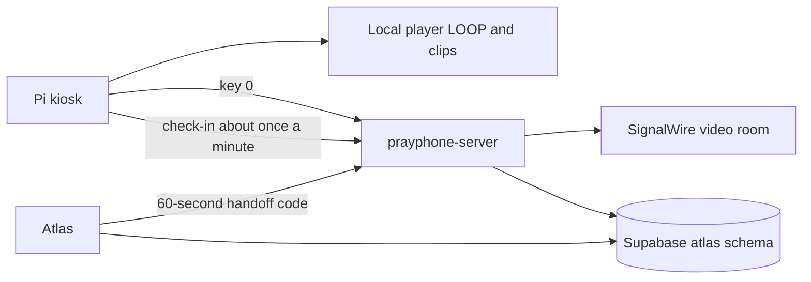

# Pray Phone system design

How the kiosk, the conferencer, and Atlas fit together. Customer language is in [README.md](./README.md). Staff steps are in [interaction-procedures.md](./interaction-procedures.md). Operator commands are in [troubleshooting.md](./troubleshooting.md).

Three repositories:

| Repository | Role |
| --- | --- |
| `prayphone-device` | Raspberry Pi kiosk: keypad, handset, local video, Chromium |
| `prayphone-server` | Conferencer. Heroku app `prayphone`, origin `https://prayphone-68d333045316.herokuapp.com` |
| `atlas` | Staff sign-in, phone icon, fleet screen, Supabase data |

The conferencer stays on prayphone-server. Atlas does not host the call page. The X on the conferencer header returns staff to the Atlas workspace at `/app` on `NEXT_PUBLIC_ATLAS_APP_ORIGIN`.



## Bill of materials

Parts named in the device repository:

| Part | What the repo says |
| --- | --- |
| Computer | Install notes name a Raspberry Pi 3B+, 4B, or 5 with Raspberry Pi OS. The model inside a given unit is ________ |
| Display | HDMI (High-Definition Multimedia Interface) display |
| Keypad | 4×3 matrix on General Purpose Input/Output (GPIO). Brand and model ________ |
| Handset | Single-pole double-throw limit switch. Common is ground. Handset model ________ |
| Camera | Camera service is written for a Camera Serial Interface (CSI) Pi Camera Module 3 (IMX708), bridged to `/dev/video8` |
| Power | ________ |
| Enclosure | ________ |
| Network | The kiosk can join a Wi-Fi network with NetworkManager (`nmcli`) when fleet config supplies a name and passphrase. The radio and how a unit is normally cabled are ________ |

## Kiosk operation

`prayphone.service` runs `src/kiosk2.py` as user `ppadmin`.

On boot the process starts a loopback bridge (`src/kiosk_bridge.py`, port 8765) and opens Chromium on `http://127.0.0.1:8765/`. That page is `src/player.html`. It plays `LOOP.mp4` from the device video directory. The default directory in `config/config.json` is `~/Videos/mp4s/`. Over-the-air updates copy `videos/` from the device repo into that directory. Idle playback does not need the network.

`LOOP.mp4` plays at startup, after every `1`–`9` clip (and after `*` / `#` when those files exist), and after every call. The local player stays. Key `0` is the only path into the hosted call.

| Key | What happens |
| --- | --- |
| `1`–`9` | Play `1.mp4`–`9.mp4`, then return to `LOOP.mp4` when the clip ends. A missing file leaves the loop playing |
| `*` / `#` | Play `star.mp4` / `hash.mp4`, then return to the loop |
| `0` | Open `https://prayphone-68d333045316.herokuapp.com/kiosk/call?bridge=http://127.0.0.1:8765&return=local&deviceId=<device id>`, plus `lastClip=<key>` when a clip was played before the press |

`_call_page_url` in `src/kiosk2.py` builds that address from `kiosk_app_url` and the device id (`ensure_device_id`: `DEVICE_ID` from the environment, else the cached id). The bridge publishes it as `callUrl` in `GET /state`. `goToCall` in `src/player.html` navigates to it and appends `lastClip` when one of `1`–`9`, `*`, or `#` played since the loop started. `return=local` sends the browser back to the local player when the call ends.

If Chromium is closed or crashes, `mpv` plays `LOOP.mp4` until Chromium starts again. Escape in the player asks the bridge to close Chromium. The next key press opens it again and carries that key.

## Keypad and hook switch

BCM (Broadcom pin numbering) in `src/kiosk2.py`. Rows are outputs. Columns are inputs with pull-down.

| Keypad row | BCM | Keypad column | BCM |
| --- | --- | --- | --- |
| Row 1 | 25 | Column 1 | 22 |
| Row 2 | 12 | Column 2 | 17 |
| Row 3 | 13 | Column 3 | 4 |
| Row 4 | 16 | | |

```
[1] [2] [3]
[4] [5] [6]
[7] [8] [9]
[*] [0] [#]
```

`config/config.json` stores `receiver_on_hook_bcm` and `receiver_off_hook_bcm`. The current file has 7 and 6. `read_hook_contact` in `src/kiosk2.py` reads those two pins. A pin at 0 is closed.

- Only the on-hook number closed returns `set`. That is the handset picked up. `session_active` becomes true.
- Only the off-hook number closed returns `reset`. That is the handset down.
- Both open or both closed returns nothing. `poll_receiver_switch` leaves `session_active` unchanged.

`poll_receiver_switch` stores `session_active` from that result. The first `set` or `reset` only stores the relay. A later change to `set` calls `unhook`, which publishes `offhook`. A later `reset` while the relay is in records the time and returns. `hang_up` runs when a following read is still `reset` and at least 80 milliseconds have passed. A `set` or an empty read before that clears the wait and does not call `hang_up`. While the relay is already dropped, a poll that still reads `reset` and finds a call session id on the bridge calls `hang_up` again. `hang_up` copies the session fields, sets the bridge receiver to `on_hook`, calls `publish_key("hook")`, then starts `_save_session_async` and `end_kiosk_call_session` for that session id. The call page calls `returnToLoop` when a bridge poll returns `receiver` `on_hook`, including a poll that does not carry a new `hook` key. A held `set` does not call `unhook` again.

Every key press is stored in the local catalog and posted to the device-log Application Programming Interface (API), `POST /api/device-logs`, with subject `keypad_press`.

## From kiosk to conference

Vocabulary used from here on: the **agent** is the staff member on `/agent`. The agent monitors the warm line and only receives calls. Everyone who presses `0` is a **caller**: the Pi kiosk on `/kiosk/call`, or the phone app on `/mobile/call`.

Key `0` loads `/kiosk/call` in the same Chromium window. `app/kiosk/call/page.tsx` mounts `components/BackendIntercom.tsx` in kiosk mode. There is no Atlas login on that page, and the page does not carry the device ingest token (`NEXT_PUBLIC_KIOSK_INGEST_TOKEN` is read by `lib/prayphoneApiHeaders.ts` only when it is set; the Heroku build does not need it for the Pi).

On mount the kiosk page opens the Pi camera and the default microphone once (`acquireKioskLocalStream` in `lib/kioskMedia.ts`), shows that stream in the bottom-right corner, and starts the call without a button press (`startCall` in `BackendIntercom.tsx`):

1. `POST /api/signalwire/calls` with body `{ triggerSource, lastClipKey?, deviceId }`. The `deviceId` is read from the page address (`getKioskDeviceId` in `lib/kioskBridge.ts`).
2. The route (`app/api/signalwire/calls/route.ts`) resolves `deviceId` with `resolveKioskCaller` (`lib/registeredKiosk.ts`): an enabled `atlas.prayphone_devices` row. `calls_as_device_id` only changes the caller address `fromAor`. An unknown or disabled id returns 403 `Unknown device`, even when a staff bearer is also present. A request with no `deviceId` must pass `requireCaller(["kiosk","atlas"])` (ingest token or Atlas bearer) or it returns 401.
3. `classifyInboundCaller` (`lib/callerClass.ts`) writes `caller_class`. `createSession` stores the session as `initiated`. For a device-credentialed create, `issueMobileCallKey` (`lib/mobileCallGate.ts`) mints a **call key** bound to that one session id. The key lives two hours (`CALL_KEY_TTL_MS`).
4. `relayInboundRing` inserts the `atlas.prayphone_inbound_rings` row and the route waits for it. `lastClipKey` is stored as a `keyword.hit` event with source `last_clip`. The session moves to `dialing` with stage `session.state.waiting_for_browser_join`. No provider leg is dialed on the warm line.
5. The response carries `sessionId`, `roomName`, and `callKey`. The page stores the key (`setKioskCallKey` in `lib/prayphoneApiHeaders.ts`) and sends it as header `x-prayphone-call-key` on every later request for that session.
6. The page posts `{ sessionId }` to the loopback bridge `POST /session` (`reportKioskCallSession`). That starts the device watchdog clock.
7. `GET /api/signalwire/calls/{sessionId}` loads the session, then `POST /api/signalwire/room-token` with `{ sessionId, participantRole: "kiosk", participantLabel: "kiosk-<first 8 of sessionId>" }` returns a SignalWire video room token.
8. `new Video.RoomSession({ token, applyLocalVideoOverlay: false, localStream })` (`@signalwire/js` 3.29.1 in `package-lock.json`) joins with `receiveAudio` and `receiveVideo` true. `publishStreamOnPeer` (`lib/roomPicture.ts`) replaces or adds the peer senders with the captured tracks and unmutes. The page then posts `{ action: "participantJoined", role: "kiosk" }` to `POST /api/signalwire/calls/{sessionId}/commands`.

While the call is open the kiosk page polls `GET /api/signalwire/calls/{sessionId}` every three seconds. State `rejected` shows "agent not available" and returns to the loop after three seconds. State `ended` or `failed` leaves the room and returns to the loop. The bridge `GET /state` is polled with backoff (one second, doubling to eight seconds while the bridge is unreachable). `receiver: "on_hook"` calls `returnToLoop`: a keepalive `POST commands { action: "end", reason: "return_loop" }` with the call key, then navigation to the local player (`return=local`). `pagehide` calls `roomSession.leave()`. A clip key pressed during the call also calls `returnToLoop`.

The Pi process itself also ends a session: `end_kiosk_call_session` in `src/kiosk2.py` posts `{ action: "end", reason }` to the same `commands` route with header `x-ingest-token`, on hang-up and on watchdog timeout. It only posts the session id stored on the bridge.

The agent page is `/agent`. `app/agent/page.tsx` mounts `components/AgentAuthGate.tsx`, then the same `BackendIntercom` in agent mode. Agent requests carry `Authorization: Bearer <Atlas access token>`. The console polls `GET /api/signalwire/calls?activeOnly=true&limit=20` every three seconds and lists waiting sessions in four queues by `caller_class`. Staff press a session row, then **answer call**. `answerCall` stops the console ringtone, posts `{ type: "prayphone-answered" }` to `window.opener`, then `joinRoom` for that one session id: `acquireBrowserLocalStream` opens camera and microphone once (camera + mic, then mic only), `POST /api/signalwire/room-token` with `participantRole: "agent"` and `participantLabel: "agent-<first 8 of sessionId>"`, then join attempts camera + mic → mic only → receive only. After the join the console posts `{ action: "participantJoined", role: "agent" }`. The console does not answer by itself, and one console answers one session at a time.

**reject call** posts `{ action: "reject", reason: "agent_rejected" }`. **end call** posts `{ action: "end" }` then leaves the room. **clear queue** asks for confirmation, then `POST /api/signalwire/calls/clear-queue` rejects every session in `initiated`, `dialing`, or `ringing` with reason `queue_cleared`; a joined call stays. All three paths end in `closeCallSession` (`lib/closeCallSession.ts`), which marks the participants `left`, writes the final state, clears the inbound ring (`cleared`), and writes the kiosk collection.

When both the kiosk participant and the agent participant are recorded as `joined` (`participantJoined` in `app/api/signalwire/calls/[sessionId]/commands/route.ts`), the session state becomes `joined` and `transitionState` in `lib/callSessionStore.ts` marks the inbound ring `answered`.

Phase 6, a design for six concurrent calls with agent identities `agent-1` through `agent-6`, is parked. It is not what this code runs.

## What each screen shows

SignalWire delivers one composite video (the Multipoint Control Unit (MCU) canvas) to every member. `layout.changed` events carry a rectangle for each member's tile. Each page crops that composite to one tile (`remoteMemberFrame` and `cropStyle` in `lib/roomPicture.ts`) and plays its own camera in a separate corner element. Nobody sees the uncropped canvas.

| Page | Main pane | Bottom-right corner | Before the main pane is ready |
| --- | --- | --- | --- |
| Agent `/agent` | The caller's tile only: the room member whose name starts `kiosk-` | The agent's own camera | "waiting for kiosk camera…" |
| Kiosk `/kiosk/call` | The agent's tile only: the room member whose name starts `agent-` | The kiosk camera, shown from page mount, before the room join | "calling the warmline…" / "please stay on the line"; after the session state is `joined` and the agent's tile is still not on the canvas, "connecting video…" / "someone answered — video is starting" |
| Mobile `/mobile/call` | The agent's tile only (`components/MobileCaller.tsx`, member name `agent-`) | The phone camera | "calling the warmline…", then "connecting video…"; a reject shows "agent not available" / "please try again later." |

`memberLooksRemote` in `BackendIntercom.tsx` matches only the opposite role prefix (`REMOTE_ROLE_PREFIX`: kiosk page → `agent-`, agent page → `kiosk-`). A stale `kiosk-` member left in the room is never shown as the agent, and the agent page never crops to another `agent-` tile. Until a matching member is on the canvas the main pane is hidden and the overlay stays. The media elements are re-synced and the crop recomputed every 1.5 seconds while joined. A rejected session shows "agent not available" / "please try again later" on the kiosk.

## Room tokens

`POST /api/signalwire/room-token` (`app/api/signalwire/room-token/route.ts`) and `mintMobileRoomToken` (`lib/mobileCallGate.ts`) call SignalWire `POST https://<space>/api/video/room_tokens` with HTTP Basic auth `SIGNALWIRE_PROJECT_ID:SIGNALWIRE_TOKEN`. The body is:

| Field | Value |
| --- | --- |
| `room_name` | The session's `roomName` (`prayphone-<uuid>`) |
| `user_name` | `kiosk-<8>` for a caller, `agent-<8>` for the agent |
| `join_as` | `member` |
| `permissions` | `room.self.audio_mute`, `room.self.audio_unmute`, `room.self.video_mute`, `room.self.video_unmute`, `room.self.deaf`, `room.self.undeaf`, `room.self.set_input_volume`, `room.self.set_output_volume`, `room.self.set_input_sensitivity`. Only these `room.self.*` entries; the list is `DEFAULT_PERMISSIONS` in the route and `ROOM_PERMISSIONS` in `mobileCallGate.ts` |
| `end_room_session_on_leave` | `true` for role `kiosk` (Pi kiosk and mobile). `false` for the agent |
| `remove_after_seconds_elapsed` | `3600` (`ROOM_MEMBER_MAX_SECONDS`) |

A caller leaving ends the SignalWire room session. An agent leaving does not. Any member is removed by SignalWire after one hour, which matches the device watchdog default.

## Who may call which route

`lib/requestAuth.ts` and `lib/mobileCallGate.ts` decide this. When neither `INGEST_TOKEN` nor the Atlas Supabase variables are set, `requireCaller` and `requireAtlas` return null and the routes are open (local development only).

| Credential | Header | Who holds it | Routes |
| --- | --- | --- | --- |
| Device id | body `deviceId` | The kiosk page (from the page address) | `POST /api/signalwire/calls` (the create only). `POST /api/signalwire/mobile-calls` uses the same lookup with `MOBILE_PROXY_DEVICE_ID` as the default |
| Call key (kiosk) | `x-prayphone-call-key` | The kiosk page, returned by the create | `POST /api/signalwire/room-token`, `GET /api/signalwire/calls/{sessionId}`, `POST …/{sessionId}/commands`, `POST …/{sessionId}/keywords`. `requireSessionCaller` accepts it only for the session it was issued for |
| Call key (mobile) | `x-mobile-call-key` | `/mobile/call`, returned by `POST /api/signalwire/mobile-calls/exchange` | `GET` and `POST /api/signalwire/mobile-calls/session` (`participantJoined`, `end`). `mobileCallKeyFrom` also reads this header on the four session-scoped routes above |
| Ingest token | `x-ingest-token` equal to `INGEST_TOKEN` (or `NEXT_PUBLIC_KIOSK_INGEST_TOKEN`) | `src/kiosk2.py` on the Pi | `POST /api/device-logs`, `POST /api/upsert-device`, `GET /api/device-config`, and `POST …/{sessionId}/commands` for the Pi's own hang-up and watchdog `end` |
| Atlas bearer | `Authorization: Bearer <Atlas access token>` with `fn_can_access_warmline_agent()` true | The agent console, through `AgentAuthGate` | `GET /api/signalwire/calls`, `POST /api/signalwire/calls/clear-queue` (Atlas only), plus every route the call key opens |

The 60-second Atlas handoff code (`atlas_handoff` fragment → `POST /api/atlas-handoff`) and the 60-second mobile handoff code (`POST /api/signalwire/mobile-calls/exchange`) are exchanged once and are not sent again.

## Caller classes

Each inbound session stores `caller_class` and `caller_label` on `atlas.prayphone_call_sessions`. Left to right on the agent console the classes are kiosk (white), anonymous (grey), enrollee (deep green), and prospective (yellow). A kiosk is an enabled `prayphone_devices` row whose `model` is not `mobile`. The phone icon's green number counts waiting sessions on `atlas.prayphone_call_sessions` whose state is `initiated`, `dialing`, or `ringing`, including a phone call. A kiosk heartbeat is not that number. The class is taken from the device that requested the call, not from `calls_as_device_id`, so `prayphone-mobile-001` stays a phone call even while its caller address is `prayphone-device-001`. With no Atlas login that call is anonymous and only appears in the grey queue. A signed-in user whose id matches `atlas.people.external_ref` is an enrollee and the button shows `display_name`, or email when the display name is empty. A signed-in user with no people row is prospective and the button shows the auth email. `atlas.prayphone_ring_sources.enabled` controls which classes ring. All four start enabled. Set `enabled` false in Supabase to silence one class. The console still answers one session at a time.

## Mobile caller

The phone app lives in the workspace at `prayphone/mobile`. It is one Expo project for iPhone and Android. The keypad is available without an account. Signing in uses the same Supabase account as the web app. Keys `1`–`9` mark a topic. Key `0` calls the agency either way.

Key `0` does not open `/kiosk/call` and does not use the Pi bridge. The app sends `POST /api/signalwire/mobile-calls` with a bearer token when someone is signed in, and with no bearer when they are not. A missing bearer still creates the call. The body includes the device id (`EXPO_PUBLIC_DEVICE_ID`, otherwise `prayphone-mobile-001`). The conferencer loads that requesting row from `atlas.prayphone_devices`. `calls_as_device_id` sets the caller address (`from_aor`) from the other phone's `signalwire_identity`. It does not choose the queue. The live call is a SignalWire video room. `signalwire_identity` is not a Session Initiation Protocol (SIP) password and it is not a separate SIP registration. The queue button shows `caller_label`.

`prayphone-mobile-001` is seeded with its own `signalwire_identity` and with `calls_as_device_id` set to `prayphone-device-001`. Key `0` on the phone therefore uses that kiosk's caller address, and the queue class stays anonymous, enrollee, or prospective because the requesting row's model is `mobile`. Clear `calls_as_device_id` to use `prayphone-mobile-001` as the caller address. `MOBILE_PROXY_DEVICE_ID` on the conferencer is the device id used when the app omits one.

The conferencer returns a 60-second code (`issueMobileHandoff` in `lib/mobileCallGate.ts`). It inserts an inbound ring for every new session and stores that session's caller class. Atlas plays the chime and turns the icon red when `atlas.prayphone_ring_sources.enabled` is true for that class. All four classes start enabled. The call screen injects that code into `/mobile/call`. The code is not a session token and is not placed in the address bar. `components/MobileCaller.tsx` posts it once to `POST /api/signalwire/mobile-calls/exchange`, which returns the SignalWire room token, the room name, the member name `kiosk-<first 8 of sessionId>`, and a call key. Later requests carry header `x-mobile-call-key` to `GET` and `POST /api/signalwire/mobile-calls/session` (`participantJoined`, `end`). The page opens the phone camera and microphone once with `getUserMedia({ audio: true, video: true })`, joins with that stream, runs `publishStreamOnPeer`, and crops the composite to the agent's tile.

Staff still answer on `/agent`, in the queue for that class. The phone joins under a `kiosk-` member name so the existing answer path can mark the room joined. Keys `1`–`9` only record which topic was pressed. Clip playback is later work.

## Atlas identity handoff

Atlas login stays in Atlas. `src/features/atlas2026/singlepane/data-access/prayphoneSubapp.ts` opens the agent origin plus `/agent`.

The built-in origin is `https://prayphone-68d333045316.herokuapp.com`. `VITE_ATLAS_PRAYPHONE_URL` can replace it. Vite reads that variable at build time (`import.meta.env` in the Atlas app, and `heroku-postbuild` runs `vite build`). A change takes effect on the next build and deploy. Docs in this repo name the Atlas Heroku app `atlas-simplified`. The slug `atlas-simplified-db949a616d2d` is ________ in this repository.

On click, `PrayPhoneListenButton` opens a window named `prayphone-agent` (`window.open('', 'prayphone-agent')`) and `openPrayPhoneAgentFromWorkspace` calls Remote Procedure Call (RPC) `atlas.fn_create_prayphone_handoff()`. That inserts a 60-second, single-use, 64-character hex code for the signed-in user. The code is placed in the address-bar fragment as `atlas_handoff` and the window is pointed at `/agent`. Because the console is opened this way, `window.opener` on the agent page is the Atlas tab. `components/AgentAuthGate.tsx` posts the code to `POST /api/atlas-handoff`, which calls `atlas.fn_consume_prayphone_handoff` and `auth.admin.generateLink({ type: "magiclink" })` and returns `token_hash`. The gate verifies that hash with `auth.verifyOtp`, and it strips the fragment before any network call. The session token is not placed in the Uniform Resource Locator (URL). A copied link cannot be reused to sign in.

A direct visit to `/agent` uses Atlas email, Google, or Apple sign-in, then the same capability check.

Capability is `atlas.fn_can_access_warmline_agent()`, which returns `atlas.fn_has_permission('warmline_agent.access')`. Administrators and supervisors are seeded with that permission. An administrator can deny a supervisor. Navigators need a non-expiring allow exception (Admin Directory, or the supervisor roster function `atlas.fn_supervisor_set_navigator_warmline_access`). Partners do not receive it by role. The permission name stays `warmline_agent.access`.

## Fleet monitoring

The Pi is not discovered by a network scan. There is no "device not found on the network" probe.

`fleet_presence_loop` in `src/kiosk2.py` posts about once a minute (`FLEET_HEARTBEAT_SECONDS = 60`) to `POST /api/upsert-device` with header `x-ingest-token`. The upsert writes `atlas.prayphone_devices.last_seen`. The same `last_seen` column is also updated when a device log is accepted (`POST /api/device-logs`).

The server application logs that upsert path only on failure: `API /upsert-device error`. A successful post is silent in the application log. Heroku router logs for app `prayphone` show the `POST /api/upsert-device` when a phone is posting: `heroku logs --tail -a prayphone`. Silence on that path means no Pi is posting.

Rows appear when a kiosk posts. Until the first successful post, `prayphone_devices` has no row for that phone.

Atlas fleet (`/fleet`) uses `FLEET_ONLINE_WINDOW_MS` in `src/features/atlas2026/fleet/fleetPresence.ts`: three minutes. A phone is online only when `last_seen` parses and is inside that window. An empty `last_seen` does not count. The stored `status` string is not the count. Two missed one-minute posts can still fall inside three minutes. The fleet screen lists phone-app rows (`model` `mobile`) as well as kiosks.

The phone icon's green number is the conferencer queue, not this window. `PrayPhoneListenButton` counts `atlas.prayphone_call_sessions` rows in `initiated`, `dialing`, or `ringing` (`src/features/atlas2026/singlepane/data-access/prayphoneQueueCount.ts`). A joined call is not in the number. An empty conferencer queue shows zero. The header refreshes that count on the same four-second poll as the inbound ring, and again when a ring row changes.

`GET /api/devices` on the conferencer selects `last_seen` (`app/api/devices/route.ts`). The conferencer page `app/devices/page.tsx` then badges a phone online with its own five-minute window. That page is not the Atlas fleet rule. Use Atlas `/fleet` for the three-minute rule.

Fleet access is `atlas.fn_can_manage_prayphone_fleet()`: administrator or supervisor JSON Web Token (JWT) claim, or an active assignment of those roles. A navigator with warm-line access still cannot open fleet settings.

Wi-Fi: an administrator or supervisor saves a network name (Service Set Identifier (SSID)) and passphrase through `atlas.fn_save_prayphone_device_config`. The passphrase lives in `atlas.prayphone_device_network`, which has Row-Level Security (RLS) and no policy for signed-in staff. The device pulls it with `GET /api/device-config` and applies `nmcli device wifi connect` only when `get_active_call_session()` is empty. The passphrase is not written to the fleet log. Each saved revision is tried once.

Supabase Realtime is enabled in migrations for `prayphone_devices` (`20261009150000_prayphone_devices_realtime.sql`) and `prayphone_inbound_rings` (`20261004200000_prayphone_inbound_rings.sql`). The Atlas project ref named in this repo is `qjsaedamqaqxobslboni`.

## Inbound ring

When a session is created, `relayInboundRing` inserts a row in `atlas.prayphone_inbound_rings` with `state = 'ringing'` and that session's `caller_class`, after the session is saved. The header accepts kiosk, anonymous, enrollee, and prospective. A missing class is stored as kiosk. A staff browser that already has warm-line access turns the phone icon red and plays a calm recorded chime for each class whose `atlas.prayphone_ring_sources.enabled` row is true. All four rows start enabled. Set one to false in Supabase to silence that class. The conferencer still stores it. The ringtone file is `sounds/ringtone.mp3`, stored with Git Large File Storage (LFS). `scripts/copy-ringtone.mjs` runs before dev and before the production build and copies it to `public/audio/ringtone.mp3`. The header requests `audio/ringtone.mp3`. The script stops when the source file is a Git LFS pointer. Heroku app `atlas-simplified` needs the Git LFS buildpack ahead of `heroku/nodejs`, plus `BUILDPACK_GIT_LFS_REPO`, or the copy is a pointer and will not play. Three seconds of silence sit between passes. The first click or keypress on the Atlas tab arms the chime for as long as that tab stays open, and asks for notification permission. After that, a waiting call plays the chime without another click, including while the tab is in the background. If the clip is blocked and notification permission was allowed, the system notification sound plays instead. An inbound call does not reload the tab, because a reload clears that arming. The icon still turns red when no sound is allowed yet.

The ring stops when the session becomes `joined` and an agent participant is recorded as joined (`answered`), or when the session is `ended`, `failed`, or `rejected` (`cleared`). Atlas ignores a `ringing` row older than two hours (`RING_MAX_AGE_MS` in `prayphoneInboundRing.ts`) so a missed clear cannot ring all day. A newer row from a class that is turned off does not hide an older enabled ring that is still inside that window.

### Agent console ringtone

The agent console has its own ringtone, separate from the Atlas header chime. `lib/agentRingtone.ts` on prayphone-server plays `public/audio/ringtone.mp3` at volume 0.35 with three seconds of silence between passes (`RING_GAP_MS`). `BackendIntercom.tsx` starts it while a waiting session is listed and this console has not pressed **answer call**. It is not started when `window.opener` is set, because the Atlas tab that opened the console is already playing its chime. A direct visit to `/agent` has no opener and rings on the console.

Pressing **answer call** stops the console ringtone at once (`agentRingtone.stop()` in `answerCall`) and posts `{ type: "prayphone-answered" }` to `window.opener` with the Atlas origin (`NEXT_PUBLIC_ATLAS_APP_ORIGIN`, or `*` when unset). `PrayPhoneListenButton` accepts that message from the window it opened, or from `configuredPrayPhoneOrigin()`, and stops its chime. The icon stays red until the ring row leaves `ringing`. The console ringtone stays silent for that session after Answer (`ringHeldRef`), and the hold is released when no session is waiting.

If the table is missing, the browser reports that `prayphone_inbound_rings` is not in the schema cache. If `caller_class` is not on the table yet, the header read fails and the icon will not turn red.

## Subjects and call interactions

`lib/clipSubjects.ts` holds a fixed phrase list. It is not a clinical instrument.

| Key | Title in code | Example phrases |
| --- | --- | --- |
| 1 | Clip 1 — presence | presence, right here, i'm here |
| 2 | Clip 2 — breath | breath, breathing, inhale, exhale |
| 3 | Clip 3 — body | body, tension, tight, pain |
| 4 | Clip 4 — grief | grief, loss, missing, died |
| 5 | Clip 5 — prayer | prayer, pray, blessing, god |
| 6 | Clip 6 — fear | afraid, fear, anxious, anxiety |
| 7 | Clip 7 — rest | tired, sleep, rest, exhausted |
| 8 | Clip 8 — belonging | alone, lonely, family, community |
| 9 | Clip 9 — gratitude | thank you, grateful, gratitude |

Extra context phrases include "i need help", "can you hear me", "are you there", "warm line", and "pray phone".

During a joined kiosk call, `lib/callKeywords.ts` uses the browser speech recognizer (`en-US`, final results only). Each matching phrase is posted to `POST /api/signalwire/calls/[sessionId]/keywords` with source `kiosk_speech`, including the short transcript that matched. The clip key in the call URL is stored once as source `last_clip` when the session is created.

Those hits become `keyword.hit` events on the call. When the session ends, fails, or is rejected, `persistKioskCollection` writes a JavaScript Object Notation (JSON) file and inserts `atlas.prayphone_kiosk_collections`. The file directory is `KIOSK_COLLECTION_DIR` or, if unset, `data/kiosk-collections` under the server working directory. The document contains the session, its events, and the keyword hits. It does not contain a media file of the call.

Keypad and hook rows are also posted as device logs (`keypad_press`, `receiver`, `hook_session`) and kept in the local catalog. The configured catalog path is `/var/lib/zoom_kiosk/kiosk.db`. That directory name is historical. If it is not writable, the process uses `~/.local/share/prayphone/kiosk.db`. A failed database write can also append `~/.local/share/prayphone/hook-sessions.jsonl`. `src/kiosk_db.py` opens plain sqlite3 and issues `PRAGMA key` only when a key file exists. That pragma does something only if the process is actually SQLCipher.

Hook-to-hook logs are how Atlas fleet ties a call session to a device: payload field `call_session_id` on subject `hook_session`.

## Over-the-air updates

`prayphone-ota.timer` runs `scripts/ota_update.sh` five minutes after boot, then hourly (`OnBootSec=5min`, `OnUnitActiveSec=1h`). The script fetches `origin/<channel>` (default `main`). When that tip differs from HEAD, it runs `git reset --hard` to that ref. Local edits inside the git checkout are discarded. It then runs `git lfs pull`, including when the revision is already current, so a failed download is retried on the next hour. Clips committed under `videos/` are stored with LFS. A valid `videos/LOOP.mp4` is copied, with `1.mp4`–`9.mp4`, `star.mp4`, and `hash.mp4`, into `~/Videos/mp4s/` (`/home/ppadmin/Videos/mp4s/` for user `ppadmin`). The player keeps reading that directory. If `LOOP.mp4` is missing or is not an MP4, that directory is left unchanged. The script restarts `prayphone.service` and the camera service when the git revision changed or a live clip changed. A retry that does not change a live file does not restart the kiosk.

Git stores a pointer for each clip. The MP4 bytes are in GitHub LFS for the same `prayphone-device` repository. On the laptop that ran `git add`, those bytes sit in `.git/lfs/objects/` until `git push`. The player directory is not a checkout. `scripts/publish_videos.sh` is what copies a validated file into it. The laptop commands are in [troubleshooting.md](./troubleshooting.md).

`prayphone-reboot.timer` reboots at 00:00 local time. `Persistent=false` is set so a missed midnight does not reboot on every boot. The boot starts another over-the-air (OTA) run five minutes later. Leave both timers as they are.

## Watchdog

`kiosk_max_call_seconds` defaults to 3600 (one hour) when unset. `0` disables the watchdog.

The clock starts when `/kiosk/call` posts a `sessionId` to loopback `POST /session`. When that session is older than the ceiling, the device posts `action: end` with reason `watchdog_timeout` for that session id only. It does not close Chromium. It does not end a session id this kiosk did not create.

## Camera

`prayphone-camera.service` waits for `/dev/video8`, then runs GStreamer: `libcamerasrc` at 1280×720, 30 frames per second, converted to YUY2, into `v4l2sink` on `/dev/video8`. Chromium uses that device as a webcam. WirePlumber's libcamera monitor is disabled so it does not take the CSI sensor. Do not replace this bridge as a side change.
